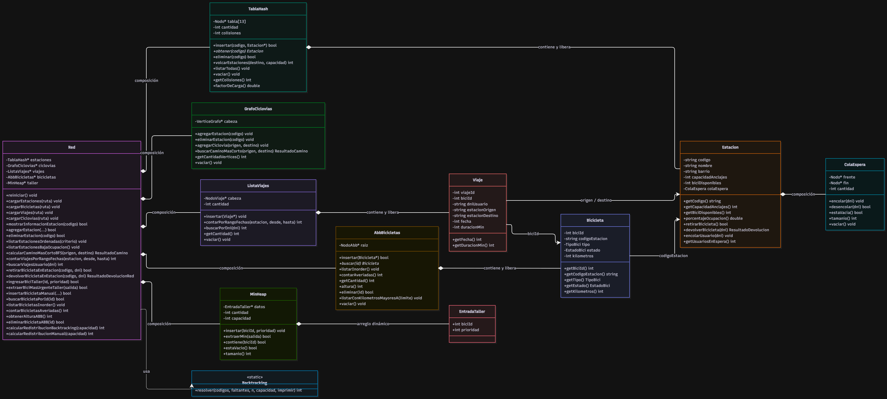

# Sistema de Bicicletas Públicas

Trabajo Práctico Final de **Algoritmos (768)**, Universidad Nacional de Hurlingham (UNAHUR).

| | |
| :--- | :--- |
| **Integrantes** | Pablo Perugini, Franco Marinozzi, Marco Musillario |
| **Grupo** | 6 |
| **Comisión** | 2 |
| **Profesora** | Lic. Martha Semken (martha.semken@unahur.edu.ar) |
| **Año** | 2026 |

El sistema modela una red urbana de bicicletas públicas: estaciones, flota, historial de viajes, red de ciclovías, taller de reparaciones y logística de redistribución. Está implementado en **C++17** con orientación a objetos, memoria dinámica administrada a mano y estructuras de datos propias. Todas las funcionalidades de las secciones A, B, C y D se prueban desde un menú por consola.

**Documentos:** [Enunciado](docs/TP2C2026.pdf) · [Diagrama de clases](docs/RedDeBicicletas.drawio.png)

## Índice

- [Inicio rápido](#inicio-rápido)
- [Requisitos de la entrega](#requisitos-de-la-entrega)
- [Aspectos técnicos y restricciones](#aspectos-técnicos-y-restricciones)
- [Estructura del repositorio](#estructura-del-repositorio)
- [Archivos de entrada](#archivos-de-entrada)
- [Menú de funcionalidades](#menú-de-funcionalidades)
- [Arquitectura y diagrama UML](#arquitectura-y-diagrama-uml)
- [Decisiones de diseño](#decisiones-de-diseño)
- [Respuestas a las consignas de análisis](#respuestas-a-las-consignas-de-análisis)
- [Verificación de calidad y memoria](#verificación-de-calidad-y-memoria)

## Inicio rápido

Requiere `g++` con soporte de C++17. El programa abre los archivos de datos por ruta relativa, así que hay que ejecutarlo desde la raíz del repositorio.

### Windows (MinGW / g++)

```bat
compilar.bat
tp.exe
```

### Linux o macOS

```bash
g++ -std=c++17 -Wall -Wextra -o tp \
    Bicicleta.cpp ColaEspera.cpp Estacion.cpp Viaje.cpp TablaHash.cpp \
    ListaViajes.cpp MinHeap.cpp AbbBicicletas.cpp GrafoCiclovias.cpp \
    Backtracking.cpp Red.cpp RedEstaciones.cpp RedViajes.cpp \
    RedBicicletas.cpp RedRedistribucion.cpp interfaz.cpp main.cpp
./tp
```

### Salida de ejemplo

Carga de los archivos de prueba (opción `1`):

```text
Ingrese una opcion: 1

Estaciones cargadas: 10
Bicicletas cargadas: 13
Viajes cargados: 21
Ciclovias cargadas: 8
```

Métricas de la tabla hash (opción `21`):

```text
=== ESTADISTICAS DE LA TABLA HASH ===
Estaciones cargadas: 10
Bicicletas registradas: 13
Viajes registrados: 21
Capacidad de la tabla: 13
Colisiones registradas: 3
Factor de carga final: 0.7692 (10/13)
```

## Requisitos de la entrega

| Requisito del enunciado | Estado |
| :--- | :---: |
| Estructuras implementadas a mano, sin contenedores prohibidos de la STL | Cumplido |
| Tabla de hash con resolución de colisiones | Cumplido |
| Cola de espera FIFO por estación | Cumplido |
| Cola de prioridad (min-heap) para el taller | Cumplido |
| ABB con inserción, búsqueda, *inorder*, averiadas, altura y liberación *postorder* | Cumplido |
| Eliminación de una bicicleta del ABB (opcional) | Cumplido |
| Redistribución con backtracking | Cumplido |
| Diagrama de clases UML con asociación y composición | Cumplido |
| Menú por consola para probar cada funcionalidad | Cumplido |
| Compilación sin warnings con `g++ -std=c++17 -Wall -Wextra` | Cumplido |

## Aspectos técnicos y restricciones

- **Sin contenedores prohibidos de la STL:** no se usan `vector`, `map`, `unordered_map`, `queue`, `priority_queue` ni `set`. Solo se emplea `std::string` y flujos (`fstream`, `iostream`) para entrada/salida y manejo de texto.
- **Estructuras de datos propias:** tabla de hash con encadenamiento, cola FIFO enlazada, lista simplemente enlazada, min-heap sobre arreglo dinámico, árbol binario de búsqueda (ABB) y grafo no dirigido con listas de adyacencia.
- **Gestión de memoria (RAII):** toda memoria reservada con `new` / `new[]` se libera en el destructor de su contenedor. El ABB libera sus nodos con un recorrido *postorder* y `Red::reiniciar()` permite recargar los archivos sin fugas ni duplicados.
- **Convenciones:** clases en `PascalCase`, métodos y variables en `camelCase`.

## Estructura del repositorio

```text
TP-Final/
├── main.cpp                         # Punto de entrada y bucle principal del menú
├── interfaz.h / interfaz.cpp        # Validación de entradas y formateo por consola
├── Red.h / Red.cpp                  # Fachada principal, ciclo de vida y carga de archivos
├── RedEstaciones.cpp                # Sección A: estaciones y BFS
├── RedViajes.cpp                    # Sección B: viajes, retiros, devoluciones y taller
├── RedBicicletas.cpp                # Sección C: gestión del ABB
├── RedRedistribucion.cpp            # Sección D: redistribución con backtracking
├── TablaHash.h / TablaHash.cpp      # Índice hash de estaciones (M = 13, encadenamiento)
├── Estacion.h / Estacion.cpp        # Modelo de estación, ocupación y cola de espera propia
├── ColaEspera.h / ColaEspera.cpp    # Cola FIFO enlazada de DNIs en espera
├── GrafoCiclovias.h / .cpp          # Grafo no dirigido de ciclovías y búsqueda BFS
├── ListaViajes.h / .cpp             # Lista enlazada simple del historial de viajes
├── Viaje.h / Viaje.cpp              # Modelo de viaje (asociación por ID y códigos)
├── AbbBicicletas.h / .cpp           # Árbol Binario de Búsqueda ordenado por bici_id
├── Bicicleta.h / Bicicleta.cpp      # Modelo de bicicleta (tipo, estado, kilometraje)
├── MinHeap.h / MinHeap.cpp          # Cola de prioridad del taller sobre arreglo dinámico
├── Backtracking.h / .cpp            # Búsqueda exhaustiva con poda para redistribución
├── compilar.bat                     # Script de compilación en Windows
├── estaciones.txt                   # Lote de prueba de estaciones
├── bicicletas.txt                   # Lote de prueba de bicicletas
├── viajes.txt                       # Lote de prueba de viajes
├── ciclovias.txt                    # Lote de prueba de conexiones entre estaciones
├── docs/
│   ├── TP2C2026.pdf                 # Enunciado del trabajo práctico
│   └── RedDeBicicletas.drawio.png   # Diagrama de clases UML
└── README.md
```

> **Modularización de `Red`:** aunque `Red` es una única clase fachada, su implementación se dividió en cinco archivos `.cpp` (`Red.cpp`, `RedEstaciones.cpp`, `RedViajes.cpp`, `RedBicicletas.cpp` y `RedRedistribucion.cpp`) para mantener archivos cortos y alineados con cada sección del enunciado.

## Archivos de entrada

Cada archivo contiene un registro por línea, con los campos separados por espacios:

| Archivo | Formato de campos | Notas |
| :--- | :--- | :--- |
| `estaciones.txt` | `codigo nombre barrio capacidad_anclajes bicis_disponibles` | `codigo` es la clave única en el hash y en el grafo. |
| `bicicletas.txt` | `bici_id codigo_estacion tipo estado kilometros` | `tipo`: `Mecanica` \| `Electrica`. `estado`: `OK` \| `Averiada`. |
| `viajes.txt` | `viaje_id bici_id dni_usuario estacion_origen estacion_destino fecha duracion_min` | `fecha` en formato entero `AAAAMMDD`. |
| `ciclovias.txt` | `estacion_a estacion_b` | Aristas no dirigidas (conexión bidireccional). |

## Menú de funcionalidades

| Sección | Opción | Funcionalidad |
| :--- | :---: | :--- |
| **Sistema** | **1** | Cargar o recargar los cuatro archivos `.txt` (reinicia las estructuras previas) |
| **A: Estaciones** | **2** | Mostrar información detallada de una estación por código |
| **A: Estaciones** | **3** | Agregar una estación nueva al sistema (hash + vértice en el grafo) |
| **A: Estaciones** | **4** | Eliminar una estación existente (sin reubicar bicicletas) |
| **A: Estaciones** | **5** | Listar estaciones ordenadas por capacidad de anclajes o por disponibles |
| **A: Estaciones** | **6** | Listar estaciones con menos del 20% de ocupación |
| **A: Estaciones** | **7** | Calcular el camino con menos tramos por ciclovías (BFS) |
| **B: Viajes y colas** | **8** | Contar viajes salientes de una estación en un rango de fechas |
| **B: Viajes y colas** | **9** | Buscar viajes por DNI y sumar los minutos pedaleados |
| **B: Viajes y colas** | **10** | Listar bicicletas con más de X kilómetros para revisión |
| **B: Viajes y colas** | **11** | Retirar bicicleta (o encolar el DNI si no hay disponibles) |
| **B: Viajes y colas** | **12** | Devolver bicicleta (asigna al primero de la cola o incrementa anclajes) |
| **B: Viajes y colas** | **13** | Taller de reparaciones: ingresar bicicleta o extraer la más urgente |
| **C: ABB de bicicletas** | **14** | Insertar una bicicleta manualmente en el ABB |
| **C: ABB de bicicletas** | **15** | Buscar una bicicleta por ID |
| **C: ABB de bicicletas** | **16** | Listar todas las bicicletas ordenadas por ID (recorrido *inorder*) |
| **C: ABB de bicicletas** | **17** | Contar bicicletas averiadas |
| **C: ABB de bicicletas** | **18** | Calcular la altura actual del ABB |
| **C: ABB de bicicletas** | **19** | Eliminar una bicicleta del ABB (hoja, un hijo o dos hijos). Opcional |
| **D: Redistribución** | **20** | Calcular combinaciones exactas de redistribución con backtracking |
| **Métricas** | **21** | Mostrar estadísticas de la tabla hash (colisiones, factor de carga, buckets) |
| **Sistema** | **0** | Liberar memoria y salir |

> **Opción 11:** el encolado no tiene una opción aislada porque modela la regla del dominio: cuando un usuario intenta retirar una bicicleta en una estación sin unidades disponibles, el sistema registra automáticamente su DNI en la `ColaEspera` de esa estación.

## Arquitectura y diagrama UML



> **Versión editable:** [Abrir `RedDeBicicletas.drawio` en diagrams.net](https://drive.google.com/file/d/1GkzTnbcySADKTKrQYvGB1vd8pk5nFUGV/view?usp=sharing)

El diagrama refleja el patrón **Fachada** centrado en `Red` y distingue tres tipos de relaciones:

- **Composición (`*--`):** `Red` crea, administra y destruye las instancias de `TablaHash`, `GrafoCiclovias`, `ListaViajes`, `AbbBicicletas` y `MinHeap`. A su vez, `Estacion` compone por valor su `ColaEspera`, `MinHeap` administra su arreglo dinámico de `EntradaTaller`, y cada contenedor libera en su destructor los objetos dinámicos que almacena (`Estacion`, `Viaje` y `Bicicleta`).
- **Asociación (`-->`):** `Bicicleta` referencia su estación mediante `codigoEstacion`, y `Viaje` referencia la bicicleta (`biciId`) y las estaciones (`origen` / `destino`) por clave lógica, sin asumir propiedad de memoria.
- **Dependencia (`..>`):** `Red` usa los métodos estáticos de `Backtracking` y le entrega arreglos auxiliares temporales para resolver la redistribución.

## Decisiones de diseño

### 1. Independencia entre la disponibilidad de las estaciones y el ABB de bicicletas

Los archivos de prueba tienen una inconsistencia de origen: `PAL` declara 35 bicicletas disponibles en `estaciones.txt`, pero en `bicicletas.txt` solo dos registros apuntan a `PAL`. `BEL` declara 44 disponibles frente a un único registro. El enunciado no pide sincronizar ambos archivos, así que se mantuvieron dos fuentes de verdad desacopladas:

- `Estacion::biciDisponibles` gobierna el cálculo de ocupación, los retiros, las devoluciones y la cola de espera.
- `AbbBicicletas` gobierna el inventario individual (búsqueda por ID, recorrido *inorder*, conteo de averiadas y filtro por kilometraje).

Cada estructura conserva así una responsabilidad única y no se inventan datos para forzar la coincidencia.

### 2. Tabla de hash de tamaño fijo (M = 13)

La tabla usa 13 buckets (número primo) y la función de dispersión:

```text
hash(codigo) = suma(codigo[i] * (i + 1)) mod 13
```

Mantener `M = 13` fijo permite reproducir las métricas de colisiones y factor de carga que pide el enunciado. La resolución por **encadenamiento** sostiene la operación correcta ante cualquier cantidad de inserciones.

### 3. ABB sin auto-balanceo

El árbol no implementa rotaciones (AVL o Red-Black). Esa decisión responde al alcance del práctico y permite observar cómo la inserción de claves ordenadas degrada la altura del árbol.

### 4. Reglas del taller de reparaciones (`MinHeap`)

El taller admite prioridades del `1` (máxima urgencia) al `3`. Si la bicicleta es de tipo `Electrica`, el sistema fuerza la prioridad a `1`. Además, valida que la bicicleta exista en el ABB y que no esté duplicada en el taller; si su estado figura como `OK`, emite un aviso pero permite el ingreso como mantenimiento preventivo.

## Respuestas a las consignas de análisis

### Complejidades temporales

| Operación / estructura | Estructura utilizada | Caso promedio | Peor caso |
| :--- | :--- | :---: | :---: |
| Búsqueda, inserción o baja de estación | `TablaHash` (M = 13, encadenamiento) | `O(1)` | `O(n)` |
| Ordenamiento de estaciones | Arreglo dinámico + inserción | `O(n²)` | `O(n²)` |
| Filtro de estaciones con menos del 20% de ocupación | Recorrido completo de `TablaHash` | `O(n)` | `O(n)` |
| Camino mínimo por ciclovías | `GrafoCiclovias` + BFS con cola | `O(V + E)` | `O(V + E)` |
| Viajes por estación y fecha, o por DNI | `ListaViajes` (lista enlazada simple) | `O(m)` | `O(m)` |
| Bicicletas con más de X kilómetros | `AbbBicicletas` (recorrido *inorder*) | `O(n)` | `O(n)` |
| Encolar o desencolar un usuario en espera | `ColaEspera` (cola FIFO enlazada) | `O(1)` | `O(1)` |
| Ingresar o extraer la bicicleta más urgente | `MinHeap` (arreglo dinámico) | `O(log n)` | `O(log n)` |
| Búsqueda o eliminación por ID en el ABB | `AbbBicicletas` (altura `h`) | `O(log n)` | `O(n)` |
| Redistribución exacta de capacidad C | `Backtracking` con poda | `O(2^n)` | `O(2^n)` |

### Sección A: gestión de estaciones

- **Tabla de hash:** con las 10 estaciones de `estaciones.txt` se registran **3 colisiones** (`CON` en el bucket 4, `BAL` en el 8 y `FLO` en el 4). El factor de carga final es `α = 10/13 ≈ 0.7692`. La búsqueda, la inserción y la eliminación son `O(1)` en promedio y `O(n)` en el peor caso, cuando todas las claves caen en el mismo bucket.
- **Ordenamiento manual:** se implementó **ordenamiento por inserción** sobre un arreglo dinámico de punteros (`Estacion**`). Cuesta `O(n²)` en el peor caso y `O(n)` si el arreglo ya está casi ordenado. Es estable y adecuado para conjuntos pequeños de estaciones.
- **Baja ocupación (menos del 20%):** recorre todos los buckets comparando `disponibles / capacidad < 0.20`, en `O(n)`. Con los datos de prueba identifica cuatro estaciones: `CAB` (16%), `CON` (15%), `BOE` (13.33%) e `ISL` (0%).
- **Camino con menos tramos (BFS):** el grafo no dirigido usa listas de adyacencia y una cola FIFO auxiliar. El costo es `O(V + E)`, óptimo en tiempo y memoria para redes urbanas dispersas frente a una matriz de adyacencia (`O(V²)`). Con los datos de prueba, ir de `PLZ` a `CON` requiere **4 tramos**: `PLZ -> CAB -> PAL -> BOE -> CON`.

### Sección B: viajes y colas de espera

1. **Viajes por estación y rango de fechas, `O(m)`.** El historial solo crece, así que la lista enlazada agrega viajes en `O(1)` sin reallocaciones. La consulta recorre los `m` registros y filtra por estación de origen y fecha inclusiva (`AAAAMMDD`). Indexar por fecha no aporta: el rango cambia en cada consulta y habría que mantener un índice nuevo.
2. **Viajes por DNI y suma de minutos, `O(m)`.** La lista no está ordenada por DNI, así que hay que recorrerla completa y acumular la duración de cada coincidencia. Un índice secundario duplicaría la memoria del historial para una consulta puntual que el enunciado no pide con frecuencia.
3. **Bicicletas con más de X kilómetros, `O(n)`.** El recorrido *inorder* del ABB visita las `n` bicicletas en orden de ID y filtra por kilometraje. El árbol está ordenado por ID, no por kilómetros, así que no existe una búsqueda directa: revisar todo el inventario cuesta `O(n)`.
4. **Cola de espera por estación, `O(1)`.** Cada estación tiene una `ColaEspera` con punteros a `frente` y `fin`, que encola y desencola en tiempo constante. La disciplina FIFO respeta el orden de llegada, que es la regla del dominio.
5. **Taller de reparaciones, `O(log n)`.** El `MinHeap` mantiene en la raíz la bicicleta con el menor valor numérico de prioridad (la más urgente). Insertar y extraer reorganizan a lo sumo la altura del árbol binario completo (`⌊log₂ n⌋`); consultar la más urgente es `O(1)`.

### Sección C: ABB de bicicletas

- El recorrido *inorder*, el conteo de averiadas, el cálculo de altura y la liberación *postorder* visitan cada nodo una vez: `O(n)`.
- La búsqueda y la eliminación dependen de la altura `h`: `O(h)`, que es `O(log n)` en un árbol balanceado y `O(n)` en un árbol degenerado. Para eliminar un nodo con dos hijos se reemplaza su dato por el **sucesor inorder** (el mínimo del subárbol derecho) y se desengancha ese sucesor.

**Carga ordenada (ejemplo con 5 bicicletas):** si se cargan `501, 502, 503, 504, 505` en orden ascendente, cada inserción se encadena por el subárbol derecho:

```text
501 -> 502 -> 503 -> 504 -> 505
```

El ABB degenera en una lista enlazada con **altura 5** medida en nodos (4 en aristas). Buscar la bicicleta `505` obliga a recorrer los 5 nodos, así que el costo pasa de `O(log n)` a `O(n)`.

En el lote de prueba hay **13 bicicletas** (`501` a `513`) cargadas en orden ascendente: la altura inicial es **13**. Al insertar manualmente la bicicleta `999` (opción 14), la altura pasa a **14**.

### Sección D: redistribución con backtracking

El algoritmo recorre el árbol binario de decisión (incluir o excluir cada estación con faltantes) y poda cuando `sumaActual > capacidad` o cuando no quedan estaciones suficientes.

- **Complejidad temporal:** `O(2^n)` en el peor caso, porque existen `2^n` subconjuntos posibles entre `n` estaciones con faltantes. La poda reduce las ramas exploradas en la práctica, pero no cambia la cota asintótica.
- **Complejidad espacial:** `O(n)`, por el arreglo booleano de selección y la profundidad máxima de la pila de llamadas recursivas.

Con el ejemplo de referencia (`C = 10` y faltantes `PLZ: 3`, `CAB: 7`, `RET: 5`, `CON: 2`, `BOE: 5`) el algoritmo encuentra exactamente **4 soluciones**:

```text
Solucion 1: {PLZ, CAB}
Solucion 2: {RET, BOE}
Solucion 3: {PLZ, RET, CON}
Solucion 4: {PLZ, CON, BOE}
```

## Verificación de calidad y memoria

- **Compilación estricta:** compila sin advertencias con `g++ -std=c++17 -Wall -Wextra`.
- **Análisis estático:** revisado con `cppcheck --enable=warning,performance,portability --inconclusive --std=c++17 *.cpp`, sin hallazgos.
- **Gestión de memoria dinámica:** cada contenedor libera en su destructor los recursos que reserva. Las clases que se usan por valor en el sistema (`Red`, `AbbBicicletas`, `ListaViajes`, `MinHeap`, `GrafoCiclovias` y `ColaEspera`) deshabilitan la copia con `= delete` para evitar copias superficiales accidentales. En Linux puede auditarse en tiempo de ejecución con:

```bash
valgrind --leak-check=full --show-leak-kinds=all ./tp
```
