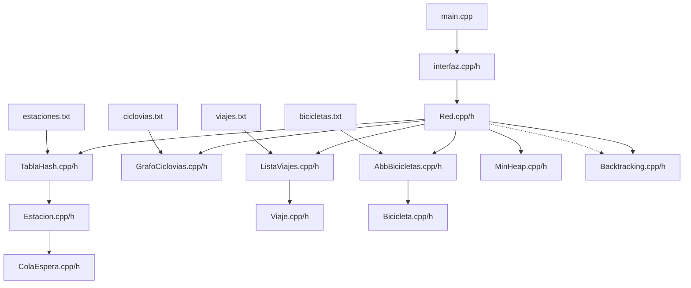
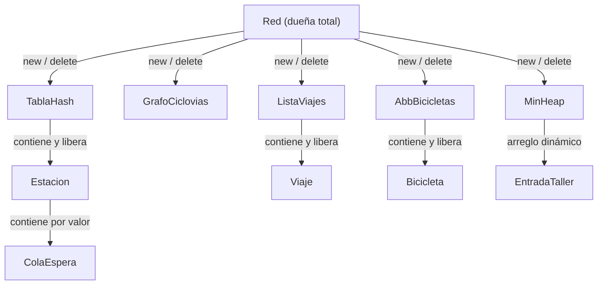
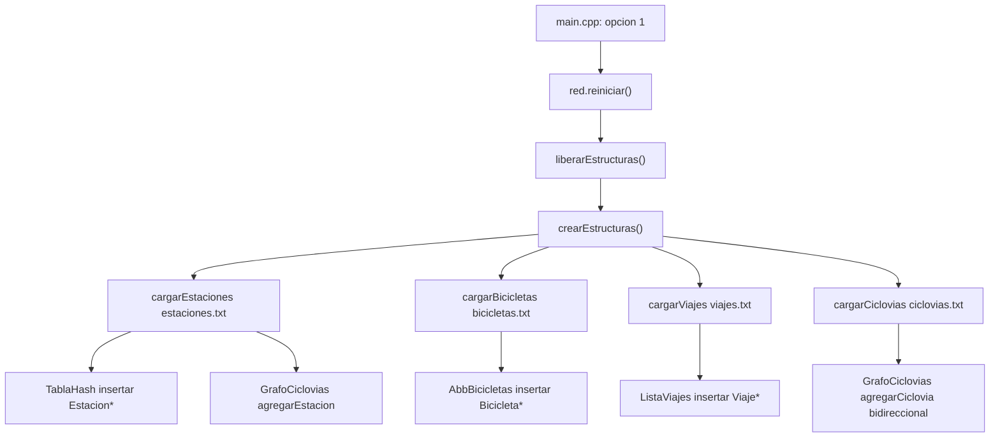
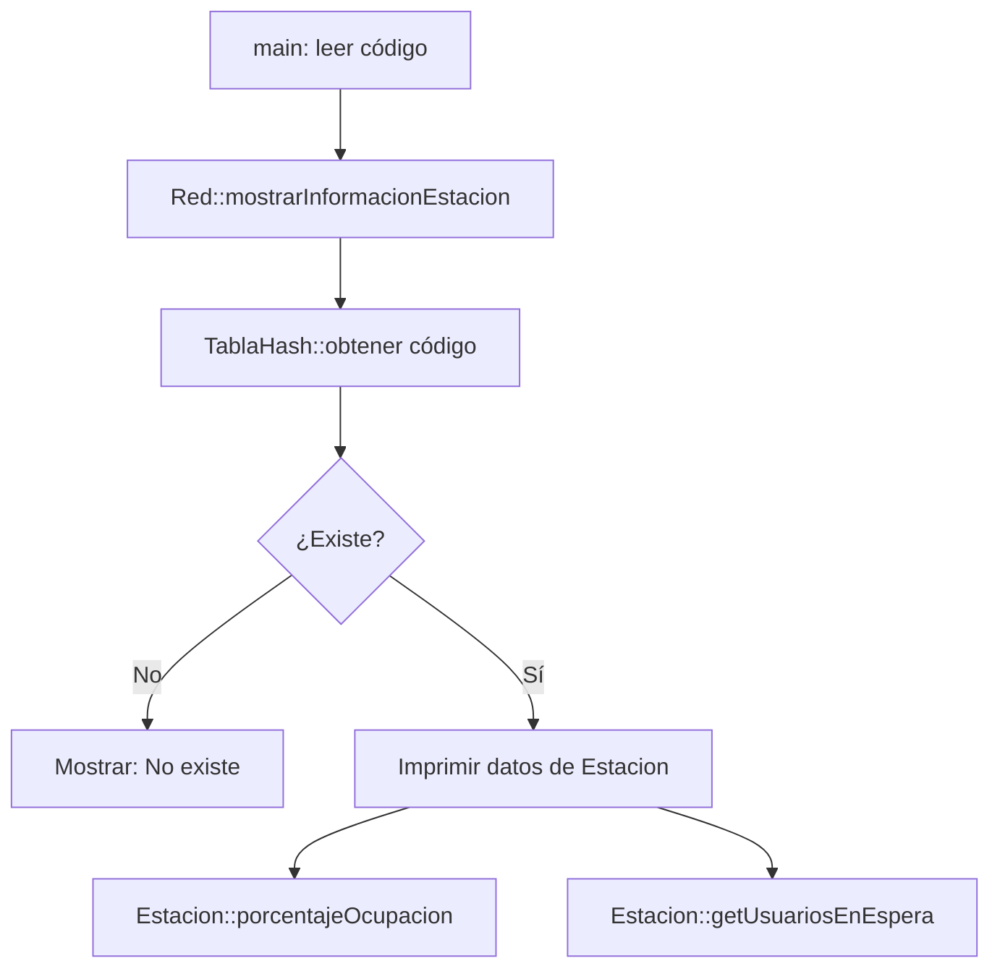
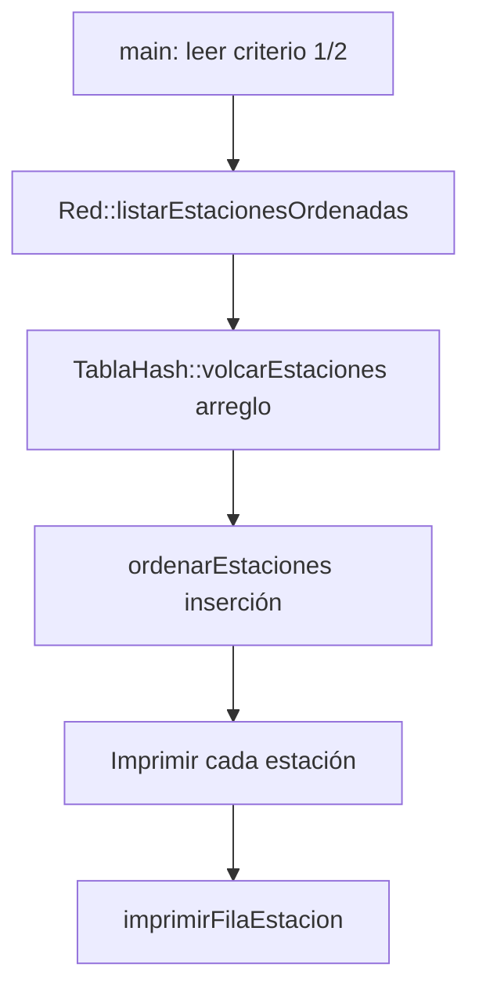
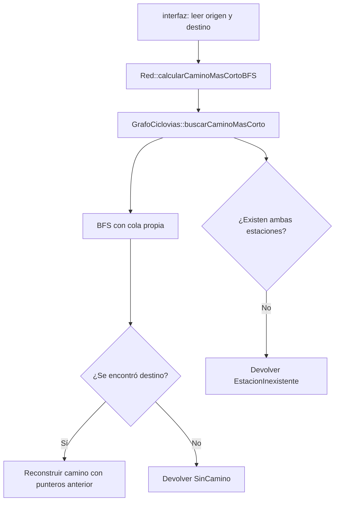
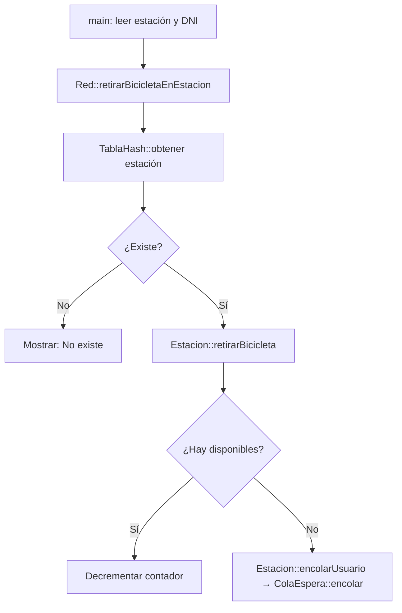
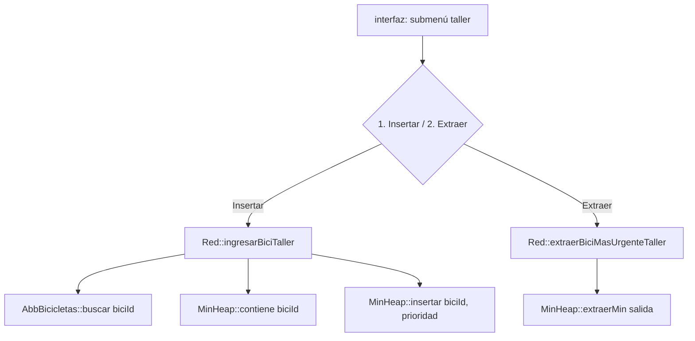
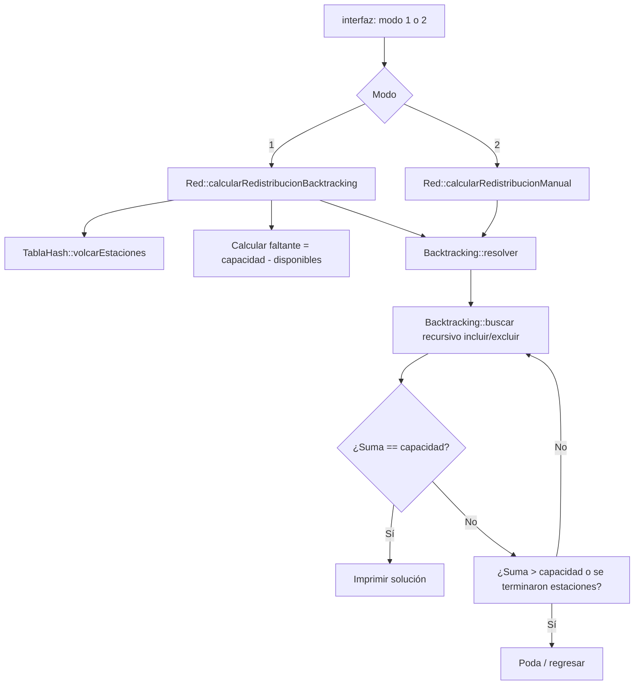

# Documentación Técnica — TP de Algoritmos (768)
## Sistema de Bicicletas Públicas (CABA)

**Archivo fuente:** `DOCUMENTACION_TP.md`  
**Carpeta del proyecto:** `C:\Users\pablo\OneDrive\Desktop\Licenciatura informatica\Segundo Año\Algoritmos (768)\TP-Final`  
**Lenguaje:** C++17  
**Compilador:** g++ 16.2.0 (MinGW-W64)

---

## Índice

1. [Descripción general del sistema](#1-descripción-general)
2. [Diagrama de interrelación de módulos](#2-diagrama-de-interrelación-de-módulos)
3. [Flujo de ejecución principal](#3-flujo-de-ejecución-principal)
4. [Opciones del menú (0 a 21)](#4-opciones-del-menú)
   - [Opción 0 — Salir](#opción-0---salir)
   - [Opción 1 — Cargar o recargar archivos .txt](#opción-1---cargar-o-recargar-archivos-txt)
   - [Opción 2 — Mostrar información de una estación](#opción-2---mostrar-información-de-una-estación)
   - [Opción 3 — Agregar una estación](#opción-3---agregar-una-estación)
   - [Opción 4 — Eliminar una estación](#opción-4---eliminar-una-estación)
   - [Opción 5 — Listar estaciones ordenadas](#opción-5---listar-estaciones-ordenadas)
   - [Opción 6 — Estaciones con baja ocupación](#opción-6---estaciones-con-baja-ocupación)
   - [Opción 7 — Camino más corto por ciclovías (BFS)](#opción-7---camino-más-corto-por-ciclovías-bfs)
   - [Opción 8 — Contar viajes por estación y rango de fechas](#opción-8---contar-viajes-por-estación-y-rango-de-fechas)
   - [Opción 9 — Buscar viajes por DNI y sumar minutos](#opción-9---buscar-viajes-por-dni-y-sumar-minutos)
   - [Opción 10 — Listar bicicletas con más de X kilómetros](#opción-10---listar-bicicletas-con-más-de-x-kilómetros)
   - [Opción 11 — Retirar bicicleta (o encolar si no hay)](#opción-11---retirar-bicicleta-o-encolar-si-no-hay)
   - [Opción 12 — Devolver bicicleta en una estación](#opción-12---devolver-bicicleta-en-una-estación)
   - [Opción 13 — Taller de reparaciones (min-heap)](#opción-13---taller-de-reparaciones-min-heap)
   - [Opción 14 — Insertar bicicleta manualmente en el ABB](#opción-14---insertar-bicicleta-manualmente-en-el-abb)
   - [Opción 15 — Buscar bicicleta por ID](#opción-15---buscar-bicicleta-por-id)
   - [Opción 16 — Listar bicicletas inorder](#opción-16---listar-bicicletas-inorder)
   - [Opción 17 — Contar bicicletas averiadas](#opción-17---contar-bicicletas-averiadas)
   - [Opción 18 — Calcular altura del ABB](#opción-18---calcular-altura-del-abb)
   - [Opción 19 — Eliminar bicicleta del ABB](#opción-19---eliminar-bicicleta-del-abb)
   - [Opción 20 — Redistribución con backtracking](#opción-20---redistribución-con-backtracking)
   - [Opción 21 — Estadísticas de la tabla hash](#opción-21---estadísticas-de-la-tabla-hash)
5. [Estructuras de datos implementadas a mano](#5-estructuras-de-datos-implementadas-a-mano)
6. [Archivos de entrada](#6-archivos-de-entrada)
7. [Cómo convertir este documento a PDF](#7-cómo-convertir-este-documento-a-pdf)

---

## 1. Descripción general del sistema

El programa es un menú por consola que gestiona un sistema de bicicletas públicas. Carga datos desde 4 archivos de texto (`estaciones.txt`, `bicicletas.txt`, `viajes.txt`, `ciclovias.txt`) y permite consultar y modificar el estado del sistema usando estructuras de datos implementadas manualmente (sin usar `vector`, `map`, `queue`, `priority_queue` ni `set` de la STL).

La clase `Red` es la fachada que compone y posee todas las estructuras:

```
Red
├── TablaHash* estaciones        (índice de estaciones por código)
├── GrafoCiclovias* ciclovias    (red de ciclovías y BFS)
├── ListaViajes* viajes          (lista enlazada de viajes)
├── AbbBicicletas* bicicletas    (ABB indexado por ID de bicicleta)
└── MinHeap* taller              (cola de prioridad del taller)
```

Cada estructura es dueña de los objetos que contiene y los libera en su destructor (RAII).

---

## 2. Diagrama de interrelación de módulos

### Arquitectura general



### Relaciones de composición (quién posee qué)



---

## 3. Flujo de ejecución principal

El punto de entrada es `main.cpp`:

```
1. Se crea un objeto `Red red`.
2. Se entra en un bucle `while(true)` que muestra el menú.
3. El usuario elige una opción numérica (0-21).
4. Si la opción no es 0 ni 1 y no hay datos cargados, se pide cargar primero (opción 1).
5. Según la opción, `main.cpp` llama a una función de `interfaz.cpp` o directamente a un método de `Red`.
6. `Red` delega en las estructuras internas (TablaHash, Grafo, ListaViajes, ABB, MinHeap, Backtracking).
7. Al elegir la opción 0, se sale del bucle y el destructor de `Red` libera toda la memoria de las 5 estructuras compuestas.
```

---

## 4. Opciones del menú (0 a 21)

A continuación se detalla cada opción del menú con su algoritmo, archivos, funciones y cómo se interrelacionan.

---

### Opción 0 — Salir

| Característica | Detalle |
|----------------|---------|
| **Archivo** | `main.cpp` |
| **Función** | `main()` — caso `case 0:` |
| **Algoritmo** | Ninguno (salida controlada del bucle) |
| **Interrelación** | Rompe el bucle principal. El destructor de `Red` se ejecuta automáticamente al salir del `main`, liberando toda la memoria de las 5 estructuras compuestas. |
| **Ejemplo de entrada** | Escribir `0` y presionar ENTER. |

---

### Opción 1 — Cargar o recargar los archivos .txt

| Característica | Detalle |
|----------------|---------|
| **Archivo** | `main.cpp` (líneas 24-31), `Red.cpp` |
| **Funciones** | `Red::reiniciar()`, `Red::cargarEstaciones()`, `Red::cargarBicicletas()`, `Red::cargarViajes()`, `Red::cargarCiclovias()` |
| **Algoritmo** | Lectura secuencial de archivos con `std::ifstream` y operador `>>` |
| **Interrelación** | |
| | 1. `main.cpp` llama a `red.reiniciar()` que libera todas las estructuras y las vuelve a crear vacías (evita duplicar datos si se carga más de una vez). |
| | 2. `cargarEstaciones("estaciones.txt")`: lee cada línea, crea `Estacion*`, inserta en `TablaHash` y registra la estación en `GrafoCiclovias`. |
| | 3. `cargarBicicletas("bicicletas.txt")`: lee cada línea, crea `Bicicleta*`, inserta en `AbbBicicletas`. |
| | 4. `cargarViajes("viajes.txt")`: lee cada línea, crea `Viaje*`, inserta en `ListaViajes`. |
| | 5. `cargarCiclovias("ciclovias.txt")`: lee pares de códigos, agrega aristas bidireccionales en `GrafoCiclovias`. |
| **Archivos de datos leídos** | `estaciones.txt`, `bicicletas.txt`, `viajes.txt`, `ciclovias.txt` |
| **Ejemplo de entrada** | No pide entrada por consola. Solo elige la opción `1` en el menú y el programa lee automáticamente los 4 archivos `.txt` de la carpeta actual. |

**Diagrama de flujo de la opción 1:**



---

### Opción 2 — Mostrar información de una estación

| Característica | Detalle |
|----------------|---------|
| **Archivo** | `main.cpp`, `RedEstaciones.cpp`, `TablaHash.cpp`, `Estacion.cpp` |
| **Funciones** | `Red::mostrarInformacionEstacion(codigo)`, `TablaHash::obtener(codigo)`, `Estacion::getNombre()`, `getBarrio()`, `getCapacidadAnclajes()`, `getBiciDisponibles()`, `porcentajeOcupacion()`, `getUsuariosEnEspera()` |
| **Algoritmo** | Búsqueda por clave en tabla hash: `hash(codigo) = suma(codigo[i] * (i+1)) mod 13`, luego recorrido de lista enlazada en el bucket hasta encontrar el código. |
| **Complejidad** | O(1) promedio, O(n) peor caso |
| **Interrelación** | `main.cpp` pide el código por consola → llama a `Red::mostrarInformacionEstacion` → esta consulta a `TablaHash::obtener` → si existe, imprime los datos de la `Estacion` incluyendo su cola de espera. |
| **Ejemplo de entrada** | Código de estación: `PLZ` |



---

### Opción 3 — Agregar una estación

| Característica | Detalle |
|----------------|---------|
| **Archivo** | `main.cpp`, `RedEstaciones.cpp`, `TablaHash.cpp`, `GrafoCiclovias.cpp` |
| **Funciones** | `Red::agregarEstacion(codigo, nombre, barrio, capacidad, disponibles)`, `TablaHash::obtener()`, `TablaHash::insertar()`, `GrafoCiclovias::agregarEstacion()` |
| **Algoritmo** | Validación de entrada + inserción en tabla hash con control de duplicados + inserción de vértice en grafo |
| **Interrelación** | `main.cpp` lee los datos por consola → `Red::agregarEstacion` valida que no exista (usando `TablaHash::obtener`), que la capacidad sea > 0 y que disponibles no exceda capacidad → si es válido, crea `Estacion*`, inserta en `TablaHash` y agrega vértice al `GrafoCiclovias`. |
| **Ejemplo de entrada** | Código: `NUE` | Nombre: `EstacionNueva` | Barrio: `NuevosRumbos` | Capacidad de anclajes: `20` | Bicicletas disponibles: `5` |

---

### Opción 4 — Eliminar una estación

| Característica | Detalle |
|----------------|---------|
| **Archivo** | `main.cpp`, `RedEstaciones.cpp`, `TablaHash.cpp`, `GrafoCiclovias.cpp` |
| **Funciones** | `Red::eliminarEstacion(codigo)`, `TablaHash::obtener()`, `TablaHash::eliminar()`, `GrafoCiclovias::eliminarEstacion()`, `Estacion::getUsuariosEnEspera()` |
| **Algoritmo** | Búsqueda en tabla hash + desenganche de nodo en lista encadenada + eliminación de vértice y sus aristas en grafo |
| **Interrelación** | `main.cpp` pide el código → `Red::eliminarEstacion` verifica existencia → avisa si hay usuarios en espera (se pierden) → elimina de `TablaHash` (liberando memoria de `Estacion` y su `Nodo`) → elimina la estación y sus aristas del `GrafoCiclovias`. |
| **Ejemplo de entrada** | Código a eliminar: `PAL` |

---

### Opción 5 — Listar estaciones ordenadas

| Característica | Detalle |
|----------------|---------|
| **Archivo** | `main.cpp`, `RedEstaciones.cpp`, `TablaHash.cpp` |
| **Funciones** | `Red::listarEstacionesOrdenadas(criterio)`, `TablaHash::getCantidad()`, `TablaHash::volcarEstaciones()`, `ordenarEstaciones()` (función anónima en archivo), `imprimirFilaEstacion()` (función anónima en archivo) |
| **Algoritmo** | **Ordenamiento por inserción (Insertion Sort)** sobre un arreglo de punteros a `Estacion`. Orden descendente por el criterio elegido (1=anclajes, 2=disponibles). Desempate por código alfabético. |
| **Complejidad** | O(n²) peor caso, O(n) si ya está casi ordenado |
| **Interrelación** | `main.cpp` pide el criterio → `Red::listarEstacionesOrdenadas` vuelca todas las estaciones de la `TablaHash` a un arreglo `Estacion**` → aplica insertion sort → imprime cada fila. |
| **Ejemplo de entrada** | Criterio: `1` (para ordenar por anclajes) o `2` (para ordenar por disponibles) |



---

### Opción 6 — Estaciones con baja ocupación

| Característica | Detalle |
|----------------|---------|
| **Archivo** | `main.cpp`, `RedEstaciones.cpp`, `TablaHash.cpp`, `Estacion.cpp` |
| **Funciones** | `Red::listarEstacionesBajaOcupacion()`, `TablaHash::volcarEstaciones()`, `Estacion::porcentajeOcupacion()` |
| **Algoritmo** | Recorrido lineal de todas las estaciones, filtrando aquellas con `disponibles / capacidad < 0.20` (menos del 20% ocupado). |
| **Complejidad** | O(n) |
| **Interrelación** | `Red::listarEstacionesBajaOcupacion` vuelca las estaciones de la tabla hash, recorre el arreglo, calcula el porcentaje de ocupación de cada una con `Estacion::porcentajeOcupacion()` e imprime las que cumplen la condición. |
| **Ejemplo de entrada** | No pide entrada. Solo elige la opción `6` y el programa muestra las estaciones con menos del 20% de ocupación. |

---

### Opción 7 — Camino más corto por ciclovías (BFS)

| Característica | Detalle |
|----------------|---------|
| **Archivo** | `main.cpp`, `interfaz.cpp`, `RedEstaciones.cpp`, `GrafoCiclovias.cpp` |
| **Funciones** | `interfaz::mostrarCamino()`, `Red::calcularCaminoMasCortoBFS()`, `GrafoCiclovias::buscarCaminoMasCorto()` |
| **Algoritmo** | **BFS (Breadth-First Search / Búsqueda en Anchura)** sobre grafo no dirigido representado con lista de adyacencia. Usa una cola propia (arreglo dinámico de punteros a vértices). Marca vértices visitados y guarda `anterior` y `distancia` para reconstruir el camino. |
| **Complejidad** | O(V + E) |
| **Interrelación** | `interfaz::mostrarCamino` pide origen y destino por consola → llama a `Red::calcularCaminoMasCortoBFS` → este delega en `GrafoCiclovias::buscarCaminoMasCorto` → BFS desde el origen hasta encontrar el destino o agotar el grafo → reconstruye el camino siguiendo punteros `anterior`. |
| **Ejemplo de entrada** | Código de origen: `PLZ` | Código de destino: `CON` |



---

### Opción 8 — Contar viajes por estación y rango de fechas

| Característica | Detalle |
|----------------|---------|
| **Archivo** | `main.cpp`, `RedViajes.cpp`, `ListaViajes.cpp`, `Viaje.cpp` |
| **Funciones** | `Red::contarViajesPorRangoFechas(estacionOrigen, fechaInicio, fechaFin)`, `ListaViajes::contarPorRangoFechas()`, `Viaje::getEstacionOrigen()`, `Viaje::getFecha()` |
| **Algoritmo** | Recorrido lineal de la lista enlazada de viajes, contando aquellos cuyo origen coincida y cuya fecha esté en el rango `[fechaInicio, fechaFin]` (formato AAAAMMDD, comparación entera directa). |
| **Complejidad** | O(m), donde m = cantidad de viajes |
| **Interrelación** | `main.cpp` lee código de estación y rango de fechas → `Red::contarViajesPorRangoFechas` → `ListaViajes::contarPorRangoFechas` recorre todos los nodos y cuenta los que cumplen ambas condiciones. |
| **Ejemplo de entrada** | Estación de origen: `PLZ` | Fecha desde (AAAAMMDD): `20260301` | Fecha hasta (AAAAMMDD): `20260331` |

---

### Opción 9 — Buscar viajes por DNI y sumar minutos

| Característica | Detalle |
|----------------|---------|
| **Archivo** | `main.cpp`, `RedViajes.cpp`, `ListaViajes.cpp`, `Viaje.cpp` |
| **Funciones** | `Red::buscarViajesUsuario(dni)`, `ListaViajes::buscarPorDni()`, `Viaje::getDniUsuario()`, `Viaje::getDuracionMin()` |
| **Algoritmo** | Recorrido lineal de la lista enlazada, imprimiendo cada viaje del DNI y acumulando las duraciones. |
| **Complejidad** | O(m) |
| **Interrelación** | `main.cpp` pide el DNI → `Red::buscarViajesUsuario` → `ListaViajes::buscarPorDni` recorre la lista, imprime coincidencias y devuelve el total de minutos acumulados. |
| **Ejemplo de entrada** | DNI del usuario: `30123456` |

---

### Opción 10 — Listar bicicletas con más de X kilómetros

| Característica | Detalle |
|----------------|---------|
| **Archivo** | `main.cpp`, `RedViajes.cpp`, `AbbBicicletas.cpp`, `Bicicleta.cpp` |
| **Funciones** | `Red::listarBicicletasParaRevision(limiteKilometros)`, `AbbBicicletas::listarConKilometrosMayoresA()`, `Bicicleta::getKilometros()` |
| **Algoritmo** | Recorrido inorder del ABB, filtrando nodos cuyos kilómetros superen el límite. |
| **Complejidad** | O(n) |
| **Interrelación** | `main.cpp` pide el límite de kilómetros → `Red::listarBicicletasParaRevision` → `AbbBicicletas::listarConKilometrosMayoresA` hace un recorrido inorder completo del árbol e imprime solo las que superan el límite. |

---

### Opción 11 — Retirar bicicleta (o encolar si no hay)

| Característica | Detalle |
|----------------|---------|
| **Archivo** | `main.cpp`, `RedViajes.cpp`, `Estacion.cpp`, `ColaEspera.cpp` |
| **Funciones** | `Red::retirarBicicletaEnEstacion(codigo, dni)`, `TablaHash::obtener()`, `Estacion::retirarBicicleta()`, `Estacion::encolarUsuario()` |
| **Algoritmo** | Consulta de disponibilidad en estación: si hay bicis disponibles, decrementa el contador; si no, encola el DNI en la cola FIFO de la estación. |
| **Complejidad** | O(1) promedio para buscar la estación + O(1) para retirar/encolar |
| **Interrelación** | `main.cpp` pide código de estación y DNI → `Red::retirarBicicletaEnEstacion` busca la estación en `TablaHash` → si existe, llama a `Estacion::retirarBicicleta()` → si retorna true, se decrementó una bici; si false, se encola el DNI con `Estacion::encolarUsuario()` → `ColaEspera::encolar`. |



---

### Opción 12 — Devolver bicicleta en una estación

| Característica | Detalle |
|----------------|---------|
| **Archivo** | `main.cpp`, `RedViajes.cpp`, `Estacion.cpp`, `ColaEspera.cpp` |
| **Funciones** | `Red::devolverBicicletaEnEstacion(codigo, dniAsignado)`, `TablaHash::obtener()`, `Estacion::devolverBicicleta()`, `ColaEspera::desencolar()` |
| **Algoritmo** | Si hay usuarios en espera, se asigna la bicicleta devuelta al primero de la cola FIFO (desencolar). Si no hay espera y hay lugar en la estación, se incrementa el contador de disponibles. Si la estación está llena, retorna `SinLugar`. |
| **Complejidad** | O(1) promedio |
| **Interrelación** | `main.cpp` pide el código de estación → `Red::devolverBicicletaEnEstacion` busca en `TablaHash` → llama a `Estacion::devolverBicicleta` → esta intenta `ColaEspera::desencolar` (asignar a espera); si falla, verifica `biciDisponibles < capacidadAnclajes` e incrementa; si no hay lugar, retorna `SinLugar`. El resultado se mapea a `ResultadoDevolucionRed` en `main.cpp`. |

---

### Opción 13 — Taller de reparaciones (min-heap)

| Característica | Detalle |
|----------------|---------|
| **Archivo** | `main.cpp`, `interfaz.cpp`, `RedViajes.cpp`, `MinHeap.cpp`, `AbbBicicletas.cpp`, `Bicicleta.cpp` |
| **Funciones** | `interfaz::ejecutarTaller()`, `Red::ingresarBiciTaller()`, `Red::extraerBiciMasUrgenteTaller()`, `MinHeap::insertar()`, `MinHeap::extraerMin()`, `MinHeap::contiene()`, `AbbBicicletas::buscar()` |
| **Algoritmo** | **Min-heap binario** sobre arreglo dinámico. Operaciones: insertar (subir/hacia arriba) y extraer mínimo (bajar/hacia abajo). Las bicicletas eléctricas se fuerzan a prioridad 1. |
| **Complejidad** | Insertar: O(log n), Extraer mínimo: O(log n), Consultar raíz: O(1) |
| **Interrelación** | `interfaz::ejecutarTaller` muestra submenú (insertar/extraer). Para insertar: `main` lee ID y prioridad → `Red::ingresarBiciTaller` valida prioridad 1-3, busca la bicicleta en `AbbBicicletas`, verifica que no esté ya en el taller (`MinHeap::contiene`), ajusta prioridad si es eléctrica, e inserta en `MinHeap`. Para extraer: `Red::extraerBiciMasUrgenteTaller` llama a `MinHeap::extraerMin`. |



---

### Opción 14 — Insertar bicicleta manualmente en el ABB

| Característica | Detalle |
|----------------|---------|
| **Archivo** | `main.cpp`, `interfaz.cpp`, `RedBicicletas.cpp`, `TablaHash.cpp`, `AbbBicicletas.cpp`, `Bicicleta.cpp` |
| **Funciones** | `interfaz::insertarBicicletaManual()`, `Red::insertarBicicletaManual(biciId, codigoEstacion, tipo, estado, kilometros)`, `TablaHash::obtener()`, `AbbBicicletas::buscar()`, `AbbBicicletas::insertar()` |
| **Algoritmo** | Inserción en árbol binario de búsqueda (ABB) ordenado por `bici_id`. No está balanceado. |
| **Complejidad** | O(h) donde h = altura del árbol (promedio O(log n), peor caso O(n)) |
| **Interrelación** | `interfaz::insertarBicicletaManual` lee todos los datos por consola → `Red::insertarBicicletaManual` valida que la estación exista en `TablaHash`, que el ID no esté ya en el ABB (`AbbBicicletas::buscar`), crea `Bicicleta*` e inserta en `AbbBicicletas::insertar`. |

---

### Opción 15 — Buscar bicicleta por ID

| Característica | Detalle |
|----------------|---------|
| **Archivo** | `main.cpp`, `RedBicicletas.cpp`, `AbbBicicletas.cpp`, `Bicicleta.cpp` |
| **Funciones** | `Red::buscarBicicletaPorId(biciId)`, `AbbBicicletas::buscar(id)`, `Bicicleta::getCodigoEstacion()`, `getTipo()`, `getEstado()`, `getKilometros()` |
| **Algoritmo** | Búsqueda en ABB: comparar el ID buscado con el nodo actual, ir a izquierda si es menor, derecha si es mayor. |
| **Complejidad** | O(h) |
| **Interrelación** | `main.cpp` pide el ID → `Red::buscarBicicletaPorId` → `AbbBicicletas::buscar` recorre el árbol hasta encontrar el nodo con ese ID o llegar a nullptr → imprime los datos de la bicicleta encontrada. |

---

### Opción 16 — Listar bicicletas inorder

| Característica | Detalle |
|----------------|---------|
| **Archivo** | `main.cpp`, `RedBicicletas.cpp`, `AbbBicicletas.cpp`, `Bicicleta.cpp` |
| **Funciones** | `Red::listarBicicletasInorder()`, `AbbBicicletas::listarInorder()`, `listarInorderRec()` (recursivo privado) |
| **Algoritmo** | Recorrido inorder (izquierda, raíz, derecha) del ABB, que imprime las bicicletas en orden ascendente por ID. |
| **Complejidad** | O(n) |
| **Interrelación** | `Red::listarBicicletasInorder` verifica que haya bicicletas → llama a `AbbBicicletas::listarInorder` → recursión inorder imprimiendo cada nodo. |

---

### Opción 17 — Contar bicicletas averiadas

| Característica | Detalle |
|----------------|---------|
| **Archivo** | `main.cpp`, `RedBicicletas.cpp`, `AbbBicicletas.cpp`, `Bicicleta.cpp` |
| **Funciones** | `Red::contarBicicletasAveriadas()`, `AbbBicicletas::contarAveriadas()`, `contarAveriadasRec()` (recursivo privado) |
| **Algoritmo** | Recorrido completo del ABB contando nodos cuyo estado sea `EstadoBici::Averiada`. |
| **Complejidad** | O(n) |
| **Interrelación** | `Red::contarBicicletasAveriadas` → `AbbBicicletas::contarAveriadas` → recursión post-order/in-order sumando 1 por cada bicicleta averiada. |

---

### Opción 18 — Calcular altura del ABB

| Característica | Detalle |
|----------------|---------|
| **Archivo** | `main.cpp`, `RedBicicletas.cpp`, `AbbBicicletas.cpp` |
| **Funciones** | `Red::obtenerAlturaABB()`, `AbbBicicletas::altura()`, `alturaRec()` (recursivo privado) |
| **Algoritmo** | Recorrido recursivo del ABB calculando `1 + max(altura_izquierda, altura_derecha)`. La altura de un árbol vacío es 0. |
| **Complejidad** | O(n) |
| **Interrelación** | `Red::obtenerAlturaABB` → `AbbBicicletas::altura` → `alturaRec(raiz)` calcula recursivamente la altura. |

---

### Opción 19 — Eliminar bicicleta del ABB

| Característica | Detalle |
|----------------|---------|
| **Archivo** | `main.cpp`, `RedBicicletas.cpp`, `AbbBicicletas.cpp`, `Bicicleta.cpp` |
| **Funciones** | `Red::eliminarBicicletaABB(biciId)`, `AbbBicicletas::eliminar(id)`, `eliminarRec()` (recursivo privado), `quitarMinimo()`, `minimo()` |
| **Algoritmo** | Eliminación en ABB con los 3 casos clásicos: nodo hoja, nodo con un hijo, nodo con dos hijos (usa sucesor mínimo del subárbol derecho). |
| **Complejidad** | O(h) |
| **Interrelación** | `main.cpp` pide el ID → `Red::eliminarBicicletaABB` → `AbbBicicletas::eliminar` busca el nodo y aplica el caso correspondiente, liberando memoria del `Bicicleta*` y del `NodoAbb`. |

---

### Opción 20 — Redistribución con backtracking

| Característica | Detalle |
|----------------|---------|
| **Archivo** | `main.cpp`, `interfaz.cpp`, `RedRedistribucion.cpp`, `TablaHash.cpp`, `Backtracking.cpp` |
| **Funciones** | `interfaz::ejecutarRedistribucion()`, `Red::calcularRedistribucionBacktracking()`, `Red::calcularRedistribucionManual()`, `Backtracking::resolver()`, `Backtracking::buscar()` |
| **Algoritmo** | **Backtracking con poda**: se incluyen o excluyen estaciones una por una. Se poda cuando la suma acumulada supera la capacidad C. Imprime todos los subconjuntos cuya suma de faltantes es exactamente C. |
| **Complejidad** | O(2^n) peor caso, O(n) memoria auxiliar por la pila de recursión |
| **Interrelación** | Hay dos modos: |
| | **Modo 1 (faltantes del sistema):** `Red::calcularRedistribucionBacktracking` vuelca estaciones de la `TablaHash`, calcula el faltante de cada una (`capacidad - disponibles`), filtra las que tengan faltante > 0, y llama a `Backtracking::resolver`. |
| | **Modo 2 (lista manual):** `Red::calcularRedistribucionManual` lee datos por consola (código y cantidad de faltantes por estación) y llama a `Backtracking::resolver`. |
| | `Backtracking::resolver` inicializa un arreglo de selección y llama a `buscar` recursivamente explorando incluir/excluir cada estación. |



---

### Opción 21 — Estadísticas de la tabla hash

| Característica | Detalle |
|----------------|---------|
| **Archivo** | `main.cpp`, `Red.cpp`, `TablaHash.cpp` |
| **Funciones** | `Red::mostrarEstadisticasHash()`, `TablaHash::getCantidad()`, `getColisiones()`, `factorDeCarga()`, `getCapacidad()`, `listarTodas()` |
| **Algoritmo** | Cálculo de métricas de la tabla hash: cantidad de elementos, colisiones, factor de carga (cantidad / 13), y listado por buckets. |
| **Complejidad** | O(n) para listar todas |
| **Interrelación** | `Red::mostrarEstadisticasHash` consulta los getters de `TablaHash` e imprime un reporte, incluyendo el contenido de cada bucket con `listarTodas()`. |

---

## 5. Estructuras de datos implementadas a mano

| Estructura | Archivo | Tipo | Uso en el sistema |
|------------|---------|------|-------------------|
| Tabla de hash con encadenamiento | `TablaHash.cpp/h` | Arreglo fijo de 13 buckets + listas enlazadas | Indexar estaciones por código |
| Grafo no dirigido | `GrafoCiclovias.cpp/h` | Lista de adyacencia con vértices y aristas enlazadas | Red de ciclovías y BFS |
| Lista enlazada simple | `ListaViajes.cpp/h` | Nodos enlazados simple | Almacenar viajes |
| Árbol binario de búsqueda (ABB) | `AbbBicicletas.cpp/h` | Nodos con punteros izquierdo/derecho | Indexar bicicletas por ID |
| Cola FIFO | `ColaEspera.cpp/h` | Nodos enlazados con frente y fin | Usuarios esperando bicicleta por estación |
| Min-heap binario | `MinHeap.cpp/h` | Arreglo dinámico con operaciones subir/bajar | Taller de reparaciones (prioridad) |
| Backtracking | `Backtracking.cpp/h` | Recursión con arreglo de selección | Redistribución de bicicletas |

Ninguna de estas usa contenedores de la STL (`vector`, `map`, `queue`, `priority_queue`, `set`), cumpliendo la restricción del TP.

---

## 6. Archivos de entrada

El programa lee los archivos desde la carpeta de ejecución (rutas relativas):

| Archivo | Formato (campos separados por espacios) | Ejemplo |
|---------|------------------------------------------|---------|
| `estaciones.txt` | `codigo nombre barrio capacidad_anclajes bicis_disponibles` | `PLZ PlazaDeMayo Monserrat 30 12` |
| `bicicletas.txt` | `bici_id codigo_estacion tipo estado kilometros` | `501 PLZ Mecanica OK 1240` |
| `viajes.txt` | `viaje_id bici_id dni_usuario estacion_origen estacion_destino fecha duracion_min` | `9001 501 30123456 PLZ PAL 20260310 25` |
| `ciclovias.txt` | `estacion_a estacion_b` (conexión bidireccional) | `PLZ CAB` |

**Nota:** El programa debe ejecutarse desde la carpeta que contenga estos archivos `.txt`.

---

## 7. Cómo convertir este documento a PDF

### Opción A: Microsoft Word (recomendado)
1. Abre **Microsoft Word**.
2. Ve a **Archivo** → **Abrir** (`Ctrl + O`).
3. Ve a la carpeta del proyecto:
   ```
   C:\Users\pablo\OneDrive\Desktop\Licenciatura informatica\Segundo Año\Algoritmos (768)\TP-Final
   ```
4. En el filtro de archivos (abajo a la derecha del cuadro de diálogo), elige **Todos los archivos (*.*)** para que aparezca el `.md`.
5. Selecciona **DOCUMENTACION_TP.md** y haz clic en **Abrir**.
6. Word abrirá el archivo como texto. Luego ve a **Archivo** → **Guardar como** → elige **PDF** en el tipo de archivo.

### Opción B: Bloc de notas + Word
1. Haz clic derecho sobre `DOCUMENTACION_TP.md` → **Abrir con** → **Bloc de notas**.
2. Copia todo (`Ctrl + A`, `Ctrl + C`).
3. Pega en un documento nuevo de Word (`Ctrl + V`).
4. **Archivo** → **Guardar como** → **PDF**.

### Opción C: WordPad
1. Clic derecho sobre el archivo → **Abrir con** → **WordPad**.
2. **Archivo** → **Imprimir** → selecciona la impresora **Microsoft Print to PDF**.

### Opción D: Navegador web
1. Copia el contenido del archivo `.md`.
2. Pégalo en un visor Markdown en línea (por ejemplo, [stackedit.io](https://stackedit.io/)).
3. Usa `Ctrl + P` → **Guardar como PDF**.

---

## Resumen rápido de algoritmos por sección

| Sección | Opciones | Algoritmo principal | Complejidad típica |
|---------|----------|---------------------|-------------------|
| A. Gestión de estaciones | 1, 2, 3, 4, 5, 6 | Tabla hash (encadenamiento) + Insertion Sort | O(1) prom / O(n²) sort |
| B. Viajes y colas | 7, 8, 9, 10, 11, 12 | BFS + búsqueda lineal + Cola FIFO | O(V+E) / O(m) / O(1) |
| C. ABB de bicicletas | 10, 14, 15, 16, 17, 18, 19 | Árbol binario de búsqueda (no balanceado) | O(h) promedio O(log n), peor O(n) |
| D. Redistribución | 20 | Backtracking con poda | O(2^n) peor caso |
| Métricas | 21 | Estadísticas de tabla hash | O(n) |

---
