# Diagrama de clases — Sistema de Bicicletas Públicas

El siguiente UML resume las clases del sistema y las relaciones que aparecen en el código. Las **composiciones** indican que el contenedor es dueño de los objetos y los libera en su destructor. Las **asociaciones** son referencias lógicas por ID o código: no implican propiedad.

```mermaid
classDiagram
    direction LR

    class Red {
        -TablaHash* estaciones
        -GrafoCiclovias* ciclovias
        -ListaViajes* viajes
        -AbbBicicletas* bicicletas
        -MinHeap* taller
        +reiniciar() void
        +cargarEstaciones(ruta) void
        +cargarBicicletas(ruta) void
        +cargarViajes(ruta) void
        +cargarCiclovias(ruta) void
        +mostrarInformacionEstacion(codigo) bool
        +agregarEstacion(...) bool
        +eliminarEstacion(codigo) bool
        +listarEstacionesOrdenadas(criterio) void
        +listarEstacionesBajaOcupacion() void
        +calcularCaminoMasCortoBFS(origen, destino) ResultadoCamino
        +contarViajesPorRangoFechas(estacion, desde, hasta) int
        +buscarViajesUsuario(dni) int
        +retirarBicicletaEnEstacion(codigo, dni) bool
        +devolverBicicletaEnEstacion(codigo, dni) ResultadoDevolucionRed
        +ingresarBiciTaller(id, prioridad) bool
        +extraerBiciMasUrgenteTaller(salida) bool
        +insertarBicicletaManual(...) bool
        +buscarBicicletaPorId(id) bool
        +listarBicicletasInorder() void
        +contarBicicletasAveriadas() int
        +obtenerAlturaABB() int
        +eliminarBicicletaABB(id) bool
        +calcularRedistribucionBacktracking(capacidad) int
        +calcularRedistribucionManual(capacidad) int
    }

    class TablaHash {
        -Nodo* tabla[13]
        -int cantidad
        -int colisiones
        +insertar(codigo, Estacion*) bool
        +obtener(codigo) Estacion*
        +eliminar(codigo) bool
        +volcarEstaciones(destino, capacidad) int
        +vaciar() void
        +getColisiones() int
        +factorDeCarga() double
    }

    class Estacion {
        -string codigo
        -string nombre
        -string barrio
        -int capacidadAnclajes
        -int biciDisponibles
        -ColaEspera colaEspera
        +getCodigo() string
        +getCapacidadAnclajes() int
        +getBiciDisponibles() int
        +porcentajeOcupacion() double
        +retirarBicicleta() bool
        +devolverBicicleta(dni) ResultadoDevolucion
        +encolarUsuario(dni) void
        +getUsuariosEnEspera() int
    }

    class ColaEspera {
        -Nodo* frente
        -Nodo* fin
        -int cantidad
        +encolar(dni) void
        +desencolar(dni) bool
        +estaVacia() bool
        +tamanio() int
        +vaciar() void
    }

    class GrafoCiclovias {
        -VerticeGrafo* cabeza
        +agregarEstacion(codigo) void
        +eliminarEstacion(codigo) void
        +agregarCiclovia(origen, destino) void
        +buscarCaminoMasCorto(origen, destino) ResultadoCamino
        +getCantidadVertices() int
        +vaciar() void
    }

    class ListaViajes {
        -NodoViaje* cabeza
        -int cantidad
        +insertar(Viaje*) void
        +contarPorRangoFechas(estacion, desde, hasta) int
        +buscarPorDni(dni) int
        +getCantidad() int
        +vaciar() void
    }

    class Viaje {
        -int viajeId
        -int biciId
        -string dniUsuario
        -string estacionOrigen
        -string estacionDestino
        -int fecha
        -int duracionMin
        +getFecha() int
        +getDuracionMin() int
    }

    class AbbBicicletas {
        -NodoAbb* raiz
        +insertar(Bicicleta*) bool
        +buscar(id) Bicicleta*
        +listarInorder() void
        +contarAveriadas() int
        +getCantidad() int
        +altura() int
        +eliminar(id) bool
        +listarConKilometrosMayoresA(limite) void
        +vaciar() void
    }

    class Bicicleta {
        -int biciId
        -string codigoEstacion
        -TipoBici tipo
        -EstadoBici estado
        -int kilometros
        +getBiciId() int
        +getCodigoEstacion() string
        +getTipo() TipoBici
        +getEstado() EstadoBici
        +getKilometros() int
    }

    class MinHeap {
        -EntradaTaller* datos
        -int cantidad
        -int capacidad
        +insertar(biciId, prioridad) void
        +extraerMin(salida) bool
        +estaVacio() bool
        +tamanio() int
        +vaciar() void
    }

    class Backtracking {
        <<static>>
        +resolver(codigos, faltantes, n, capacidad, imprimir) int
    }

    class EntradaTaller {
        +int biciId
        +int prioridad
    }

    Red *-- TablaHash : composición
    Red *-- GrafoCiclovias : composición
    Red *-- ListaViajes : composición
    Red *-- AbbBicicletas : composición
    Red *-- MinHeap : composición

    TablaHash *-- Estacion : contiene y libera
    Estacion *-- ColaEspera : composición
    ListaViajes *-- Viaje : contiene y libera
    AbbBicicletas *-- Bicicleta : contiene y libera
    MinHeap *-- EntradaTaller : arreglo dinámico

    Bicicleta --> Estacion : codigoEstacion
    Viaje --> Bicicleta : biciId
    Viaje --> Estacion : origen / destino
    Red ..> Backtracking : usa
```

## Lectura del diagrama

- **Composición (`*--`):** `Red` crea y destruye la tabla, el grafo, la lista de viajes, el ABB y el heap. `Estacion` contiene su `ColaEspera` por valor. La tabla, la lista, el ABB y el heap son dueños de los objetos que guardan y los liberan en sus destructores.
- **Asociación (`-->`):** `Bicicleta` guarda el código de su estación, `Viaje` guarda el ID de la bicicleta y los códigos de origen/destino. Son referencias lógicas; no se liberan desde esas clases.
- **Dependencia (`..>`):** `Red` usa `Backtracking` para resolver la redistribución, pero no lo posee. `Backtracking` recibe arreglos auxiliares y no toma ownership.
- **Relación con el PDF:** la tabla de hash indexa las estaciones, el grafo representa las ciclovías, la lista conserva los viajes, el ABB indexa las bicicletas por ID, el min-heap administra el taller y el backtracking resuelve los subconjuntos de faltantes.
